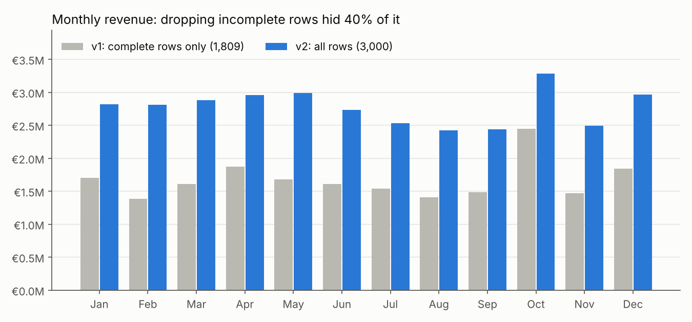
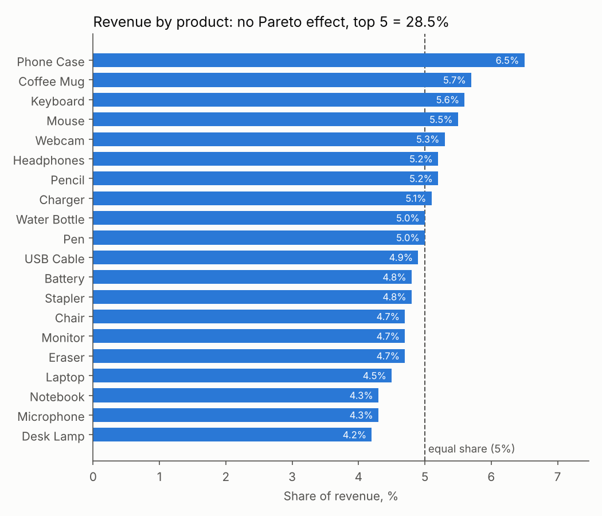
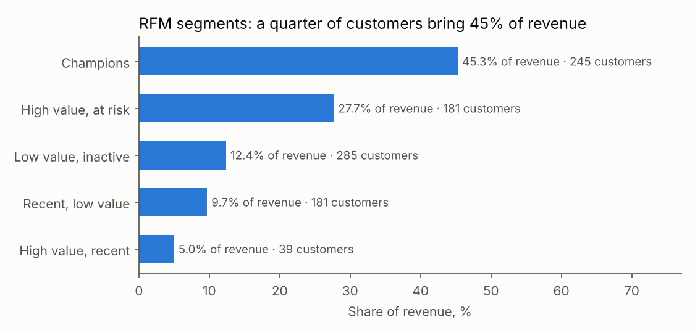

# Sales & Orders Analysis

Retail sales analysis in Python and SQL: data quality audit, exact recovery of missing values, a SQLite star schema with analysis queries, and a Power BI model. Built during my IHK retraining as *Fachinformatiker für Daten- und Prozessanalyse*.

The dataset holds 3,000 transactions from 5 stores and 20 products over calendar year 2024. It is synthetic (generated with AI assistance) and contains deliberate gaps, so cleaning is part of the task.

## What changed in version 2

The first version dropped every row with any missing value. That kept 1,809 of 3,000 rows and **understated revenue by 40%**. Version 2 keeps every row:

| | v1: complete rows only | v2: all rows |
|---|---|---|
| Orders | 1,809 | **3,000** |
| Revenue | €20,045,147.82 | **€33,321,414.00** |
| Average order value | €11,080.79 | €11,107.14 |
| Known customers | 837 | 931 |



Revenue is never missing in the source, and `revenue = quantity × unit_price × (1 − discount)` holds to the cent. That makes most gaps solvable:

- **637 of 665** rows with a missing number were recovered exactly (218 quantities, 216 prices, 229 discounts). When two numbers are missing, a value is filled in only if exactly one combination fits the constraints: a whole quantity from 1 to 99 and a discount of 0, 5, 10, 15, 20 or 25%.
- **28 rows** stay incomplete: quantity and price are both missing, which has no unique solution. They still count for revenue.
- Missing customer, payment method and category become `Unknown`. Every filled-in field is listed in the column `recovered`, so nothing is hidden.

## Data quality findings

- **The category field cannot be trusted.** Every product appears under all five categories (a coffee mug is recorded as Electronics, Furniture, Beverages…). Category totals in v1 were therefore meaningless; v2 does not use them. See [`sql/07_data_quality.sql`](sql/07_data_quality.sql).
- **Prices vary from about €5 to €500 for the same product**, and product IDs are not stable per product. Analysis therefore groups by product name.

In a real company, both findings would go back to the owners of the product master data before any category report is published.

## Results (v2, all rows)

- **No Pareto effect:** revenue is spread almost evenly. The top product (Phone Case) has 6.5%, and the top 5 together have 28.5%, close to the 25% an equal split would give.
- **Customers:** a quarter of known customers (245 "Champions") bring 45% of revenue. A further 181 high-value customers have not bought for about five months on average, which makes them a target for re-activation.
- **Seasonality:** October is the strongest month (€3.28 M, +34.5% vs September), August the weakest (€2.42 M).
- **Stores:** S004 and S001 each bring 21.5% of revenue, S002 the least (18.7%). S005 has the lowest average order value (€10,434).





## SQL

`src/build_db.py` loads the clean data into a SQLite star schema (`fact_sales` plus five dimensions) and runs every query in [`sql/`](sql/). The outputs are saved in [`sql/results/`](sql/results/).

| Query | Technique |
|---|---|
| [`02_kpis.sql`](sql/02_kpis.sql) | v1 vs v2 KPIs with `UNION ALL` |
| [`03_monthly_trend.sql`](sql/03_monthly_trend.sql) | month-over-month change with `LAG`, running total, share of year |
| [`04_pareto_products.sql`](sql/04_pareto_products.sql) | `RANK`, cumulative share with a window frame |
| [`05_store_comparison.sql`](sql/05_store_comparison.sql) | best month per store with `ROW_NUMBER() OVER (PARTITION BY …)` |
| [`06_customer_segments.sql`](sql/06_customer_segments.sql) | RFM segmentation with `NTILE(4)` |
| [`07_data_quality.sql`](sql/07_data_quality.sql) | category and price consistency, recovery summary |

## Power BI

[`powerbi/`](powerbi/) holds the star schema as CSV, the DAX measures ([`measures.dax`](powerbi/measures.dax)) and a step-by-step [build guide](powerbi/README.md) for a three-page report: overview, products and stores, data quality.

## Project structure

```
sales-orders-dashboard/
├── data/
│   ├── store_dataset_3000_rows.csv   # raw transactions
│   ├── sales_clean.csv               # v2: all rows, recovered values flagged
│   ├── sales.db                      # SQLite star schema
│   └── cleaned_sales_data.csv        # v1 output (complete rows only)
├── src/
│   ├── clean_sales.py                # recovery of missing values
│   ├── build_db.py                   # SQLite load, run queries, Power BI export
│   └── charts.py                     # README charts
├── sql/                              # schema + analysis queries, results/
├── powerbi/                          # model tables, DAX measures, build guide
├── notebooks/
│   └── sales_analysis.ipynb          # v1 exploratory analysis
├── images/
└── requirements.txt
```

## How to run

```bash
python -m pip install -r requirements.txt
python src/clean_sales.py   # data/sales_clean.csv
python src/build_db.py      # data/sales.db, sql/results/, powerbi/*.csv
python src/charts.py        # images/
```

## Tech stack

Python · pandas · SQLite / SQL (CTEs, window functions) · Power BI / DAX · matplotlib · Jupyter

## Author

Šarūnas Ramanauskas, Fachinformatiker für Daten- und Prozessanalyse (in training), Moers / Duisburg, Germany.
