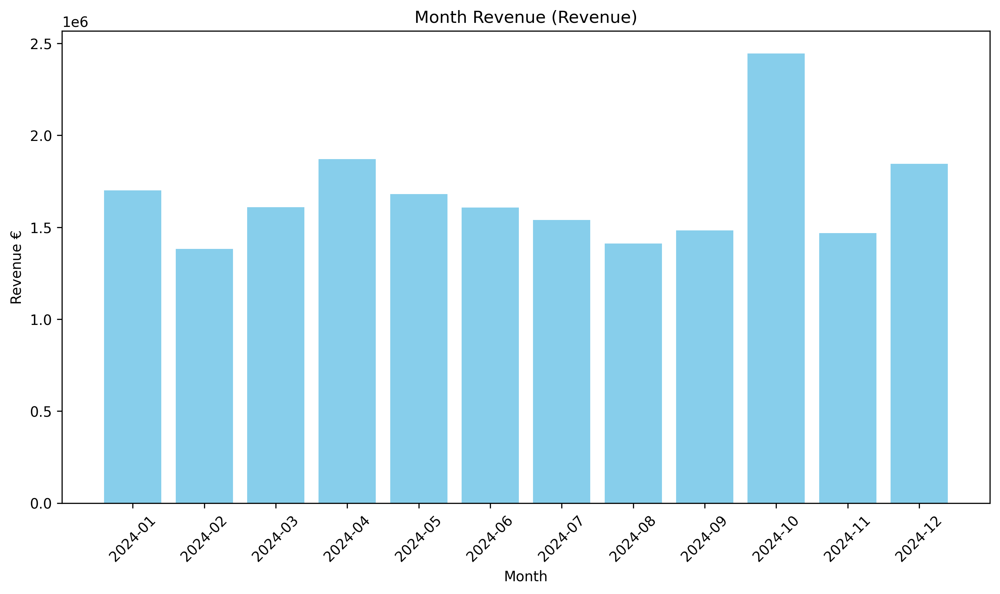
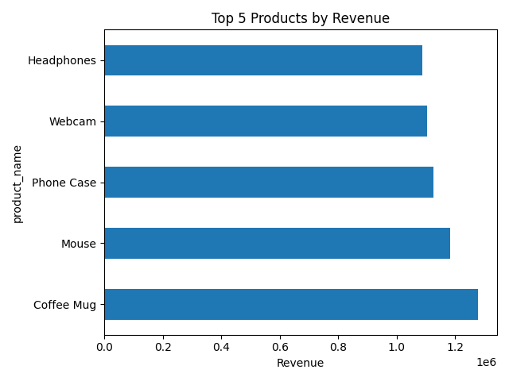
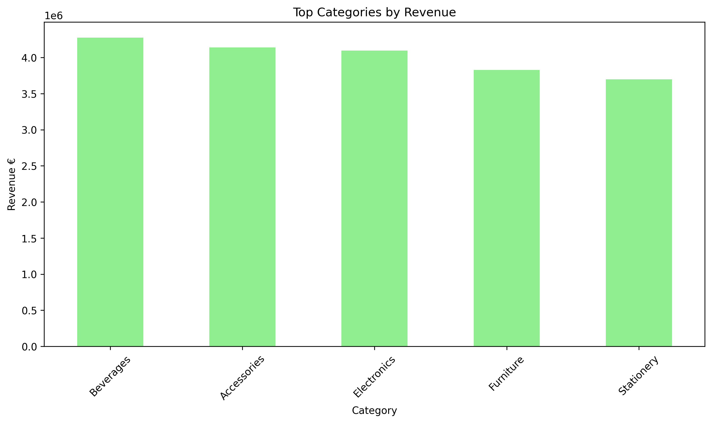

# Sales & Orders Analysis

Retail sales analysis in Python: data cleaning, KPI calculation and charts for business stakeholders. Built during my IHK retraining as *Fachinformatiker für Daten- und Prozessanalyse*.

The dataset holds 3,000 transactions from 5 stores, 20 products and 5 categories over calendar year 2024. It is synthetic (generated with AI assistance) and contains deliberate gaps, so cleaning is part of the task.

## Results

| KPI | Value |
|---|---|
| Revenue (complete rows) | €20,045,147.82 |
| Orders (complete rows) | 1,809 |
| Average order value | €11,080.79 |
| Top product | Coffee Mug, €1.28 M |
| Top category | Beverages, 21.3% of revenue |

- **Product concentration:** the top 5 products bring in 28.8% of revenue.
- **Customers:** the top 5 customers account for only 2.6% of revenue, so there is no dependency on single accounts.
- **Categories:** revenue is spread evenly; the five categories range from 18.5% to 21.3%.
- **Seasonality:** October is the strongest month (€2.45 M), February the weakest (€1.38 M). Month-over-month changes average 19.5% in either direction.



| Top products | Top categories |
|---|---|
|  |  |

## Data cleaning

- No duplicate rows were found.
- Six columns (category, quantity, unit price, discount, customer, payment method) each have 240 missing values, mostly in different rows.
- The notebook drops every row with any missing value. That keeps 1,809 of 3,000 rows (60.3%), so the KPIs above describe the complete rows only. Revenue itself has no gaps, and `revenue = quantity × unit_price × (1 − discount)` holds to the cent, which makes several gaps recoverable (see next steps).

## Project structure

```
sales-orders-dashboard/
├── data/
│   ├── store_dataset_3000_rows.csv   # raw transactions
│   └── cleaned_sales_data.csv        # after cleaning
├── images/                           # charts used in the README (+ interactive Plotly HTML)
├── notebooks/
│   └── sales_analysis.ipynb          # full analysis
└── requirements.txt
```

## How to run

```bash
python -m pip install -r requirements.txt
cd notebooks
jupyter notebook sales_analysis.ipynb
```

The notebook reads from `../data/` and writes charts to `../images/`.

## Tech stack

Python · pandas · matplotlib · Plotly · Jupyter

## Next steps

- Recover missing values instead of dropping rows: category from the product name, quantity from revenue, price and discount.
- Compare stores and payment methods.
- Load the cleaned data into SQL and build a Power BI report on top of it.

## Author

Šarūnas Ramanauskas, Fachinformatiker für Daten- und Prozessanalyse (in training), Moers / Duisburg, Germany.
